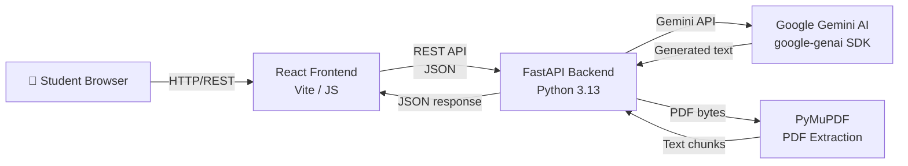

# AI Study Assistant Agent

> A full-stack AI-powered academic study companion built with **React + Vite**, **FastAPI**, and **Google Gemini AI**.  
> Designed for college mini-project demonstration and viva.

---

## Problem Statement

Students lack a single, intelligent tool that can explain concepts, generate structured study notes, create custom quizzes, build personalised study schedules, and answer questions from uploaded study material — all in one place.

## Objectives

1. Provide an AI-powered conversational tutor for academic topics.
2. Generate structured, level-appropriate study notes on demand.
3. Create multiple-choice quizzes with scoring and explanations.
4. Build personalised daily study schedules based on available time and exam dates.
5. Enable document-grounded Q&A on uploaded PDF study material.

---

## Features

| Feature | Description |
|---|---|
| 🤖 AI Tutor | Multi-turn academic chat with conversation history |
| 📝 Notes Generator | Structured notes with concepts, examples, and revision questions |
| ❓ Quiz Generator | MCQ quizzes with scoring and per-question AI explanations |
| 📅 Study Planner | Personalised daily study schedule generation |
| 📄 Document Q&A | PDF upload + grounded question answering |

---

## Architecture



---

## Technology Stack

| Layer | Technology |
|---|---|
| Frontend | React 18, Vite 6, React Router, React Markdown |
| Backend | Python 3.13, FastAPI 0.115, Uvicorn |
| AI | Google Gemini (`gemini-1.5-flash`) via `google-genai` SDK |
| PDF | PyMuPDF (fitz) |
| Validation | Pydantic v2, Pydantic-settings |
| Testing | pytest, FastAPI TestClient |
| Config | python-dotenv |
| Deployment | Render (Static Site + Web Service) |

---

## Folder Structure

```
ai-study-assistant-agent/
├── frontend/               # React + Vite
│   ├── src/
│   │   ├── pages/          # Dashboard, AiTutor, NotesGenerator, QuizGenerator, StudyPlanner, StudyDocuments
│   │   ├── components/     # MarkdownView, ErrorBanner, LoadingDots
│   │   ├── api.js          # REST API client
│   │   ├── App.jsx
│   │   └── index.css
│   ├── .env.example
│   └── vite.config.js
├── backend/
│   ├── app/
│   │   ├── main.py         # FastAPI app, CORS, routers
│   │   ├── config.py       # Settings (pydantic-settings)
│   │   ├── api/            # Route handlers
│   │   ├── services/       # gemini_service, document_service, agent_service
│   │   ├── schemas/        # Pydantic request/response models
│   │   └── core/           # security.py
│   ├── tests/              # pytest suite
│   ├── requirements.txt
│   └── .env.example
├── docs/
│   └── PROJECT_REPORT.md
├── render.yaml             # Render Blueprint
├── .gitignore
└── README.md
```

---

## Prerequisites

- **Node.js** 18+ and npm 9+
- **Python** 3.11+
- A **Google Gemini API key** (free tier): https://aistudio.google.com/app/apikey
- **Git**

---

## Local Setup — Windows PowerShell

### 1. Clone the repository
```powershell
git clone https://github.com/YOUR_USERNAME/ai-study-assistant-agent.git
cd ai-study-assistant-agent
```

### 2. Backend setup
```powershell
cd backend
python -m venv venv
.\venv\Scripts\Activate.ps1
pip install -r requirements.txt
```

Create `backend\.env` (copy from `.env.example`):
```powershell
Copy-Item .env.example .env
```

Edit `backend\.env`:
```
GEMINI_API_KEY=AIzaSy...your_real_key_here
GEMINI_MODEL=gemini-1.5-flash
FRONTEND_ORIGIN=http://localhost:5173
MAX_UPLOAD_MB=10
```

Start the backend:
```powershell
uvicorn app.main:app --reload --host 0.0.0.0 --port 8000
```

The API docs are available at: http://localhost:8000/docs

### 3. Frontend setup
```powershell
cd ..\frontend
npm install
```

Create `frontend\.env`:
```powershell
Copy-Item .env.example .env
```

`frontend\.env` should contain:
```
VITE_API_BASE_URL=http://localhost:8000
```

Start the frontend:
```powershell
npm run dev
```

Open http://localhost:5173 in your browser.

---

## Environment Variables

### Backend (`backend/.env`)

| Variable | Required | Default | Description |
|---|---|---|---|
| `GEMINI_API_KEY` | ✅ | — | Your Google Gemini API key |
| `GEMINI_MODEL` | ❌ | `gemini-1.5-flash` | Gemini model ID |
| `FRONTEND_ORIGIN` | ❌ | `http://localhost:5173` | Allowed CORS origin |
| `MAX_UPLOAD_MB` | ❌ | `10` | Maximum PDF upload size |

### Frontend (`frontend/.env`)

| Variable | Required | Default | Description |
|---|---|---|---|
| `VITE_API_BASE_URL` | ❌ | `http://localhost:8000` | Backend URL |

> ⚠️ **Security**: Never prefix the Gemini API key with `VITE_`. All AI calls happen server-side.

---

## Gemini API Key Setup

1. Visit https://aistudio.google.com/app/apikey
2. Sign in with your Google account.
3. Click **Create API Key**.
4. Copy the key (starts with `AIza`).
5. Paste it into `backend/.env` as `GEMINI_API_KEY`.

### Supported Models (free tier)
| Model | Notes |
|---|---|
| `gemini-1.5-flash` | **Recommended** — fast, generous free quota |
| `gemini-1.5-pro` | Higher quality, lower rate limits |
| `gemini-2.0-flash` | Latest generation |

To change the model, update `GEMINI_MODEL` in `backend/.env`.

---

## API Endpoints

| Method | Path | Description |
|---|---|---|
| GET | `/health` | Root health check |
| GET | `/api/health` | API health check with version |
| POST | `/api/chat` | AI tutor chat |
| POST | `/api/notes/generate` | Generate study notes |
| POST | `/api/quizzes/generate` | Generate MCQ quiz |
| POST | `/api/planner/generate` | Generate study plan |
| POST | `/api/documents/upload` | Upload PDF for processing |
| POST | `/api/documents/ask` | Ask a question about uploaded PDF |
| GET | `/docs` | Swagger UI (interactive API docs) |

---

## Running Tests

```powershell
cd backend
.\venv\Scripts\Activate.ps1
pytest tests/ -v
```

Tests mock all Gemini API calls — no API quota is consumed.

### Integration Test (requires real API key)
```powershell
# With a valid GEMINI_API_KEY in .env:
pytest tests/test_integration.py -v -s
```

---

## GitHub Setup

```powershell
cd c:\path\to\ai-study-assistant-agent
git init
git add .
git commit -m "feat: initial AI Study Assistant Agent"
git remote add origin https://github.com/YOUR_USERNAME/ai-study-assistant-agent.git
git branch -M main
git push -u origin main
```

> ⚠️ Ensure `.gitignore` excludes `.env` files before pushing.

---

## Render Deployment

### Prerequisites
- A free Render account: https://render.com
- Your repo pushed to GitHub.

### Option A: Blueprint (render.yaml)
1. Go to https://dashboard.render.com/blueprints
2. Click **New Blueprint Instance**.
3. Connect your GitHub repository.
4. Render reads `render.yaml` and creates both services automatically.
5. In the backend service environment variables, set:
   - `GEMINI_API_KEY` = your real Gemini key
   - `FRONTEND_ORIGIN` = your Render frontend URL (e.g. `https://ai-study-assistant.onrender.com`)
6. In the frontend build, set:
   - `VITE_API_BASE_URL` = your Render backend URL (e.g. `https://ai-study-backend.onrender.com`)

### Option B: Manual
**Backend (Web Service):**
- Environment: Python 3
- Root Directory: `backend`
- Build Command: `pip install -r requirements.txt`
- Start Command: `uvicorn app.main:app --host 0.0.0.0 --port $PORT`
- Health Check Path: `/health`

**Frontend (Static Site):**
- Root Directory: `frontend`
- Build Command: `npm install && npm run build`
- Publish Directory: `dist`

---

## Troubleshooting

| Problem | Solution |
|---|---|
| `GEMINI_API_KEY` not set error | Add your key to `backend/.env` |
| CORS error in browser | Ensure `FRONTEND_ORIGIN` matches your frontend URL exactly |
| PDF has no readable text | The PDF may be scanned — only text-based PDFs are supported |
| 429 Quota Exceeded | Wait and retry; consider using `gemini-1.5-flash` |
| Frontend can't reach backend | Check `VITE_API_BASE_URL` in `frontend/.env` |
| Render backend sleeping | Free tier sleeps after 15 min inactivity; first request wakes it |

---

## Known Free-Tier Limitations

1. **Render sleep**: Free backend services sleep after 15 minutes of inactivity. The first request after sleep takes ~30 seconds.
2. **Ephemeral filesystem**: Uploaded PDFs are stored in memory and lost on restart. Re-upload is required after a restart.
3. **No persistent storage**: Conversation history is not persisted. SQLite is not used on Render's ephemeral filesystem.
4. **Gemini quotas**: Free tier has rate limits (~15 RPM, 1M tokens/day for `gemini-1.5-flash`).
5. **PDF extraction**: Only text-based PDFs work. Scanned image PDFs require OCR (not implemented).

---

## Future Enhancements

- OCR support for scanned PDFs (Tesseract/Google Vision).
- User authentication and persistent conversation history (Firebase / Supabase).
- Flashcard generation from notes.
- Voice input and text-to-speech output.
- Subject-specific agent personas.
- Export quiz results as PDF.
- Mobile app (React Native).
